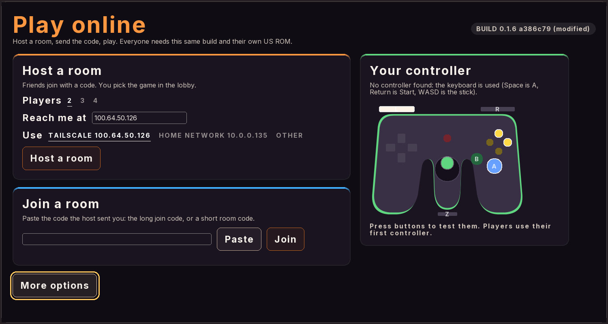
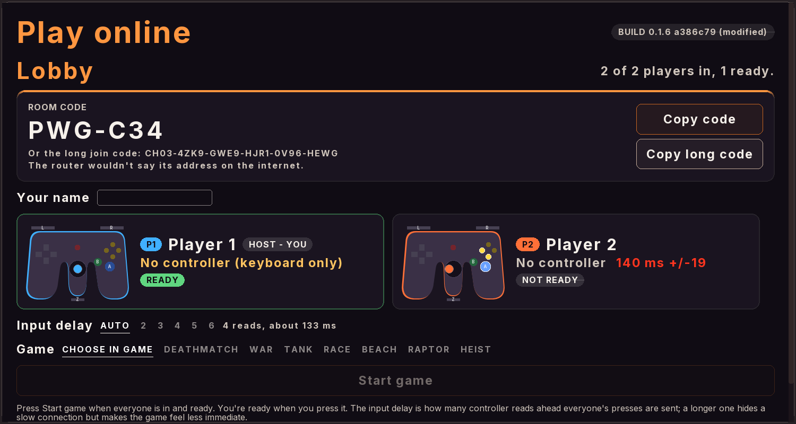

# Conker's Bad Fur Day: Recompiled, Netplay Edition

A personal fork of [sciaschi/CBFD-Recompiled](https://github.com/sciaschi/CBFD-Recompiled), the
native PC port of **Conker's Bad Fur Day** (N64, US version) built with
[N64Recomp](https://github.com/N64Recomp/N64Recomp), [N64ModernRuntime](https://github.com/N64Recomp/N64ModernRuntime)
and [RT64](https://github.com/rt64/rt64). This fork exists to play Conker's multiplayer **online with friends**,
on Linux, macOS and Windows, from builds that need only each player's own ROM.

> **This repository contains no game data.** You need your own legally obtained copy of the US ROM
> (big-endian `.z64`, SHA-1 `4cbadd3c4e0729dec46af64ad018050eada4f47a`). It is never committed.

It's an independent fork, not affiliated with Rare, Microsoft, Nintendo or the upstream project's
maintainers. Please report problems with it here, not upstream.

## What this fork does differently

The renderer, the recompilation, widescreen, controls and the rest of the port are upstream's. This fork
changes the following.

| Change | Where |
|---|---|
| **Netplay is part of every build.** Upstream builds its online multiplayer only with `-DCONKER_NETPLAY=ON`; this fork's releases always have it. The netplay code itself (lockstep, join codes, the Netplay menu, the determinism checks) is upstream's, written by [easymod0](https://github.com/easymod0), merged here from upstream's `main`. | [`tools/netplay/README.md`](tools/netplay/README.md) |
| **A trimmed launcher:** Start Game, Netplay, Controls, Controller Test, Graphics & Sound, Add ROM and Exit. The Version switch and the Mods menu are gone. | [`host/src/frontend.cpp`](host/src/frontend.cpp) |
| **Buttons named for your controller.** The menus used to show Xbox glyphs for every pad. They now follow the controller player 1 uses (found from SDL's own controller type): Xbox, PlayStation (Cross, Circle, Square, Triangle, L1/R1, and the DualSense Share, Options and touchpad) or Nintendo (L/R, Minus, Plus, Home). | [`host/src/controller_glyphs.cpp`](host/src/controller_glyphs.cpp), [`recomp/recompfrontend.patch`](recomp/recompfrontend.patch) |
| **A pre-game lobby for netplay.** After hosting or joining, everyone sees who is in: a name each (kept between runs), a Ready button for joiners, the host's join code with a Copy button, and a Start game button the host can press once every place is taken and every joiner is ready. Before, the game started the moment the last player joined. This changes upstream's handshake (protocol version 6: small `Lobby`, `Roster`, `LobbyPad`, `Ping` and `Pong` packets), and the host drops a joiner that floods it with lobby messages. | [`host/src/netplay/lobby.cpp`](host/src/netplay/lobby.cpp), [`host/src/netplay/net/`](host/src/netplay/net/) |
| **A lobby that shows if everyone is ready to play.** Each player's controller type, a live view of their pad (every button and the stick, as the game would read it) and their ping are shown to all. The host's input delay is recommended from the worst ping and jitter (or set by hand) and is sent to everyone at Start. Joiners are refused with the reason (a different build, ROM or mods). | [`host/src/netplay/lobby.cpp`](host/src/netplay/lobby.cpp), [`host/src/netplay/lockstep.cpp`](host/src/netplay/lockstep.cpp) |
| **A look of its own for the online part.** The Netplay page is now "Play online": Host and Join cards, and a drawing of an N64 controller (the real trident shape, with the buttons where they are on the pad) that shows your own controller live; in the lobby every player gets the same drawing, lit by what they press as the game would read it, next to their name, ping and ready tag, and the room code is shown large with its copy buttons. The launcher entry is tinted to match. Everything is drawn from RecompUI elements and one small SVG, so it follows each player's colour and any window size. | [`controller_view.cpp`](host/src/netplay/controller_view.cpp), [`lobby.cpp`](host/src/netplay/lobby.cpp), [`menu.cpp`](host/src/netplay/menu.cpp) |
| **Easier connecting.** Your address is filled in from this computer's Tailscale or home-network address (with a picker), the join code can be pasted from the clipboard, and the port, player count, address and name are remembered. **Copy diagnostics** puts the build, settings and recent connection log on the clipboard for bug reports. | [`host/src/netplay/addresses.cpp`](host/src/netplay/addresses.cpp), [`settings.cpp`](host/src/netplay/settings.cpp), [`diag.cpp`](host/src/netplay/diag.cpp) |
| **A game-mode picker.** The host can pick Deathmatch, War, Tank, Race, Beach, Raptor or Heist (and which entry of its list) in the lobby, and Start takes everyone straight into that match: the menus are pressed by a script that every machine runs the same way, so nobody has to click through them together. It is a port of `tools/netplay/make_match.py`, checked against it for every mode and player count, and a loopback test shows both copies end up byte-for-byte where a solo replay of the same match does, whatever their controllers do meanwhile. The game's own menus are still one choice away ("Choose in game"). The protocol is now version 7 (`Start` carries the mode). | [`host/src/netplay/net/matchscript.cpp`](host/src/netplay/net/matchscript.cpp), [`host/src/netplay/lockstep.cpp`](host/src/netplay/lockstep.cpp) |
| **Short room codes, a router helper and Tailscale-aware joining.** A small room server ([`tools/room_server/`](tools/room_server/): one Python file, standard library only, run in a terminal and, for friends outside a tailnet, published with `tailscale funnel`) turns the long join code into a six-character one. The host registers its Tailscale, home-network and public addresses with it and keeps the room alive; a joiner types the code, the game keeps only the addresses worth trying from where it is (a Tailscale address only if it has Tailscale too, a home-network address only on the same /24) and tries them in turn until one answers. The host also asks the router to forward its port (UPnP) and says plainly when it can't (no UPnP, or the router is behind carrier-grade NAT, where Tailscale is the way). The server only holds addresses while a room is open and never sees game traffic or the ROM; the long join codes still work with no server at all. | [`tools/room_server/`](tools/room_server/), [`roomclient.cpp`](host/src/netplay/roomclient.cpp), [`upnp.cpp`](host/src/netplay/upnp.cpp) |
| **A Controller Test page.** Shows every connected controller with its name and family, each button as a glyph that lights while held, both sticks as dots, and the triggers as bars. It reads the controllers itself, so nothing reaches the game or the menus; hold Start (or Esc) for a second and a half to leave. | [`host/src/controller_test.cpp`](host/src/controller_test.cpp) |
| **Fewer settings.** The Camera, Mouse & Gyro, Achievements and Mods tabs and the notification and texture pack settings are hidden. They are still created, so the code that reads them finds their defaults and the game behaves as before. | [`host/src/conker_config.cpp`](host/src/conker_config.cpp) |
| **A different look:** a dark plum background with an orange accent and softer corners, set through RecompFrontend's theme. | [`host/src/launcher_theme.cpp`](host/src/launcher_theme.cpp) |
| **Release packaging that needs no ROM in the cloud:** a portable Linux tarball, a macOS DMG, and a Windows build that compiles from stored, already-recompiled sources. | [`tools/release/`](tools/release/), [`windows-release.yml`](.github/workflows/windows-release.yml) |
| **A manual upstream sync:** a workflow you start by hand that opens a pull request with whatever is new in upstream's `main`. It never merges anything itself. | [`sync-upstream.yml`](.github/workflows/sync-upstream.yml) |

Hidden is not removed: achievements, mods, texture packs and save states are still in the code. Mods and
save states are switched off during a netplay match anyway, as upstream's settings profile fixes them.
Upstream's [README](https://github.com/sciaschi/CBFD-Recompiled#readme) lists the full feature set.

## Status

This is experimental. What has and hasn't been checked:

- **Checked:** upstream's determinism check and its two-copy lockstep check pass on a Linux build of this
  fork (headless). The lobby, the scripted game modes and the room server were run with two copies of the
  game on one Linux machine (a host and a joiner met through the room server, and both ended up with the
  same game memory as a solo replay of the same match). The Linux, macOS and Windows release builds
  (build 7) carry the same build id, from the same clean commit; the Windows one was built in GitHub's cloud.
- **Not checked yet:** a real match between two machines on different networks; UPnP on a real router;
  Tailscale Funnel from outside a tailnet; controllers in the lobby; running the Windows build at all (it compiles
  and has the right build id, but has not been launched); the Windows and macOS builds of the room client.
- **Limits of netplay:** a host has to be reachable: the same Tailscale network, a forwarded UDP port (the
  game asks the router for it with UPnP, which not every router allows), or the room server's public
  address. There is no relay: if two players can't reach each other directly the match can't happen. A join
  code is the host's address, port and a match key, so give it only to people you trust. A match starts from
  boot with an empty save. Everyone must run the **same build**: the handshake refuses a different commit,
  ROM, settings profile or mods.
- **Not built:** an in-launcher update check (use the manual sync workflow below) and an Apple TV port.

## Playing online

1. Every player gets the same release (or builds the same commit) and loads their own US ROM in the launcher
   the first time.
2. The host opens **Netplay**, picks the number of players, the port and the address friends will use (the
   Tailscale and home-network addresses are filled in; a Tailscale address works without port forwarding),
   and presses **Host**. The lobby shows a join code, and a short code too if a room server is set.
3. The others open **Netplay** and paste the join code (or type the short code), and join the lobby.
4. In the lobby everyone sees names, controller types, pings and a live view of each controller. Joiners press
   **I'm ready**; the host can pick the input delay (Auto is chosen from the pings) and a game mode (or leave
   it to the game's own menus), and presses **Start game**.

Each player uses their first controller. Mouse and gyro aiming, and the free camera, are switched off during a
match so every machine runs the same game. **Copy diagnostics** (in the lobby) puts a report on the clipboard
to send with a bug report.

The Netplay page, with the player's own controller drawn live (press a button and it lights), and the lobby, where
each player's controller is drawn the same way, so a pad that doesn't answer or a slow connection shows before the
match starts:





## Running a room server

Optional. A room server turns the long join code into a short one such as `K7Q-F2M` and lets joiners try the
host's Tailscale, home-network and public addresses in turn. It is one Python file with no dependencies
(Python 3.9 or later), run in a terminal on any machine the players can reach, and it never sees game traffic
or the ROM; it holds a host's addresses only while the room is open.

    python3 tools/room_server/room_server.py --port 27080

Friends outside your Tailscale network need a public address: with Tailscale Funnel enabled for your network
(Tailscale's admin page), `tailscale funnel --bg --https=8443 27080` publishes it as
`https://<your-machine>.<tailnet>.ts.net:8443` (8443 and 443 are two of the ports Funnel allows; use one that
isn't already serving something). Everyone then types that address under **Room server** on the Netplay page,
once; it is remembered. The server's API is described in [`tools/room_server/API.md`](tools/room_server/API.md).
The game talks to it through the system `curl` (present on macOS, Windows 10 and later, and most Linux).

## Testing a build

What to try between two machines, and what to send back if something is wrong:

1. Host and join by the **long join code**, over Tailscale; get to the lobby, check each side sees the other's
   name, controller type, ping and live pad (press buttons), press Ready and Start, and play a minute.
2. Host with a **game mode** picked (War or Race are quick); everyone should land in the match without
   touching a menu.
3. Run a room server, set its address on both machines, and join by the **short code**.
4. Try a join with a deliberately wrong build or ROM: the lobby should say which.
5. If anything fails, press **Copy diagnostics** on each machine and send the text, with what you were doing.

## Getting a build

Releases are on this repository's Releases page: `ConkerRecompiled-<tag>-Linux.tar.gz` (run `ConkerRecomp`
inside it; it needs Vulkan, SDL2, GTK 3 and FreeType from the system, and carries protobuf and libcrypto
itself), a macOS `.dmg` (Apple Silicon, macOS 15 or later; it isn't notarised, so the first time choose
**Open Anyway** in System Settings > Privacy & Security), and a Windows `.zip`. The packages contain no game
data. To build it yourself, follow the guides below, with netplay on: set `CONKER_CMAKE_ARGS=-DCONKER_NETPLAY=ON`
before `build.sh` or `build.cmd`.

## For the maintainer

- A release is built from one clean, committed commit on every platform; the build id includes the commit and
  marks uncommitted changes `-dirty-`, and netplay refuses mismatched builds.
- `tools/release/package_linux.sh` and `tools/release/package_macos_dmg.sh` package a finished build. The
  Windows workflow builds from a `RecompiledFuncs-*.zip` asset of a release in this repository. **That asset
  is derived from a ROM. Keep the repository private while it exists, and delete it first if you ever make
  the repository public.**
- The workflows inherited from upstream (`build`, `netplay`, `netplay-transport`, `release`) expect upstream's
  secrets and public clones, so they skip or fail here.

## What you need to build it

- The **US** ROM of Conker's Bad Fur Day in big-endian `.z64` format, with
  SHA-1 `4cbadd3c4e0729dec46af64ad018050eada4f47a`. It is never committed: the
  build extracts what it needs from your copy.
- A folder path without an apostrophe (`'`) to clone into. Some of RT64's build
  steps break on one.

Then follow the guide for your system: [Windows](#building-on-windows),
[Linux](#building-on-linux) or [macOS](#building-on-macos). Each is one command
once the tools are installed. The first full build takes a while, because the
recompiled game is a lot of C code.

## Building on Windows

Windows 10 or 11 (x64). Everything builds natively; `build.cmd` does all of it.

### 1. Install the tools (once)

- [Git for Windows](https://git-scm.com/download/win).
- [Python 3](https://www.python.org/downloads/). In the installer, tick *Add
  python.exe to PATH*.
- **Visual Studio 2022 or later** with the *Desktop development with C++*
  workload. The free *Build Tools for Visual Studio* edition is enough.

### 2. Get the code and build

In a Command Prompt, in the folder you want it in (for example `D:\Games`), with
the path to your ROM:

```bat
git clone --recursive https://github.com/sciaschi/CBFD-Recompiled.git
cd CBFD-Recompiled
build.cmd "C:\path\to\your\conker.z64"
```

The first build takes a while. When it's done, the game is
`host\build-win\ConkerRecomp.exe` (see [Playing](#playing)).

### Updating

```bat
git pull
build.cmd
```

The script updates the submodules and their patches, and only rebuilds what
changed.

## Building on Linux

Tested on Ubuntu 24.04 (x86-64). You need a Vulkan driver: Mesa's, which most
distributions install by default, or NVIDIA's.

```sh
git clone --recursive https://github.com/sciaschi/CBFD-Recompiled.git
cd CBFD-Recompiled
./build.sh ~/path/to/your/conker.z64
```

On Ubuntu and Debian, the script lists the packages it's missing and offers to
install them. On other distributions, install the equivalents of `git python3
cmake ninja-build clang pkg-config libsdl2-dev libdbus-1-dev libfreetype-dev`
yourself. When it's done, run `host/build/ConkerRecomp` (see [Playing](#playing)).

To update: `git pull`, then `./build.sh` again.

## Building on macOS

macOS on Apple Silicon or Intel. The game renders with Metal. `build.sh` does all
of it, as on Linux.

### 1. Install the tools (once)

- **Xcode**, from the App Store. The Command Line Tools alone aren't enough: RT64
  compiles its shaders with Xcode's Metal compiler. Open Xcode once to finish its
  setup. If `xcode-select -p` doesn't print a path inside `Xcode.app`, run
  `sudo xcode-select -s /Applications/Xcode.app`.
- [**Homebrew**](https://brew.sh).
- Optionally, for building mods: `brew install llvm` (Apple's clang can't compile
  for the N64's MIPS processor).

### 2. Get the code and build

In Terminal, in the folder you want it in, with the path to your ROM:

```sh
git clone --recursive https://github.com/sciaschi/CBFD-Recompiled.git
cd CBFD-Recompiled
./build.sh ~/path/to/your/conker.z64
```

Put the ROM's path in quotes if it has spaces or an apostrophe, for example
`./build.sh "$HOME/Downloads/Conker's Bad Fur Day (USA).z64"`.

The first build takes a while. If some tools are missing, the script lists the
Homebrew packages (`cmake ninja pkg-config sdl2 freetype`) and offers to install
them. It also offers to download Xcode's Metal Toolchain (about 850 MB), which
Xcode 26 and later install separately. When it's done, the game is
`host/build/ConkerRecomp` (see [Playing](#playing)).

To turn it into a standalone `ConkerRecomp.app` that runs without Homebrew (as the
release workflow does), run `sh host/package_macos.sh` after `brew install
dylibbundler`. The app ends up in `host/build/`.

### Updating

```sh
git pull
./build.sh
```

The script updates the submodules and their patches, and only rebuilds what
changed.

## What the build does

`build.sh` holds the full sequence, if you'd rather run the steps yourself:

1. Checks your ROM (copied to `conker/baserom.us.z64`) and applies the patches in
   `recomp/` to N64Recomp, N64ModernRuntime and RT64.
2. Builds N64Recomp.
3. Runs `recomp/recompile.py`, which unpacks the game's code from your ROM and
   recompiles it into `RecompiledFuncs/`. Which functions there are, and where,
   comes from `recomp/conker.us.syms.toml`: names, addresses and sizes, but no
   code. The code itself only ever comes from your ROM.
4. Builds the game (`host/`) with CMake.

### Working on the decompilation

`recomp/conker.us.syms.toml` (and `mods/syms/`) are generated from the
decompilation in `conker/`, which needs its own Linux tools: IDO, which runs
through the MIPS binutils, and the Python packages in `requirements.txt`. On
Linux, macOS, or in WSL on Windows, `./build.sh --decomp` builds the decompilation
too, checks that it rebuilds your ROM's code byte for byte, and regenerates those
files from it (`recomp/run.sh`). The decompilation is a work in progress, and
most of the code is still the original assembly.
[DevOldSchool's conkers-bfd-decomp](https://github.com/DevOldSchool/conkers-bfd-decomp)
is further along, and this project follows its progress
([issue #57](https://github.com/sciaschi/CBFD-Recompiled/issues/57)).

On macOS, `--decomp` also needs `coreutils` and `mips-linux-gnu-binutils` from
Homebrew (the script offers to install them). The decompilation comes with two
Linux programs, the IDO compiler and a patched gzip that compresses exactly as the
original game's did, so the script puts macOS replacements in `tools/macos/`:
IDO's macOS build from
[ido-static-recomp](https://github.com/decompals/ido-static-recomp), and GNU gzip
1.10 built with the same one-line change.

## Playing

Run `host/build/ConkerRecomp` (Linux and macOS) or `host\build-win\ConkerRecomp.exe`
(Windows). The first time, pick **Load ROM** in the launcher and select your ROM
(the same `baserom.us.z64` works). After that it's remembered, so just choose
**Start Game**. With **Start Game Directly** on the General tab, the game starts as
soon as the program opens, without the launcher (turn it off in the settings while
playing to get the launcher back).

- **Settings** (in the launcher, or Esc / the controller's menu button in game)
  has its options by tab: General (deadzone, rumble), Camera (turning, the free
  camera, field of view, aiming with the stick), Mouse & Gyro, Graphics
  (resolution, aspect ratio, anti-aliasing, frame rate, texture packs), Controls,
  Sound, Achievements and Mods. The tabs scroll sideways when they don't all fit.
- **Achievements** are the program's own, for reaching the game's scenes (the
  ones its Chapters menu lists), from the first death to the end credits. They're
  kept on this computer, in `achievements.txt` with the settings, and the
  Achievements tab lists them. Only what you do in play counts: scenes a save
  had already reached unlock when a new game reaches them. **Achievement
  Notifications** on the General tab turns off the line in the corner as one
  unlocks; they still unlock and are listed. **Notifications** above it turns off
  every line the program shows in the corner (achievements, save states, the
  texture pack's F8), and each kind has its own setting too.
- Saves, settings and the stored ROM live in `~/.config/ConkerRecompiled` on
  Linux, `~/Library/Application Support/ConkerRecompiled` on macOS and
  `%LOCALAPPDATA%\ConkerRecompiled` on Windows. Put an empty `portable.txt` next
  to the executable to keep them there instead.
- **Save states**: F5 saves the game exactly as it is, F7 loads it back, F6
  picks the next of the nine slots (rebind them, to keys, mouse or controller
  buttons, in the Controls tab's **Hotkeys**). They never touch the game's own saves. See
  [docs/save-states.md](docs/save-states.md). **Save State Notifications** on the
  General tab turns off the line in the corner saying a state was saved or loaded,
  or another slot picked (one saying it couldn't be still shows).
- Default keyboard controls: move with WASD, A = Space, B = Left Shift,
  Z = Q, L = E, R = R, Start = Enter, C buttons = arrow keys, D-pad = IJKL.
  Everything can be remapped in Controls.
- N64 pads and adapters for real N64 controllers (raphnet-tech's, Mayflash,
  Hyperkin, the NSO and 8BitDo 64 controllers) are mapped from
  `assets/controllerdb.txt`, with the C buttons as the right stick. A controller
  SDL doesn't know can be given a mapping in the `SDL_GAMECONTROLLERCONFIG`
  environment variable, which takes precedence.

## ROM hacks

A ROM hack that only changes the game's assets (its audio, textures, models or
text), such as an uncensored patch that restores the bleeped words, plays like the
US ROM. The recompiled code only comes from the ROM's code, which has to be the US
ROM's, so hacks that change the game's code are refused. A hack that repacks the
game's compressed code without changing it, as the Russian fan translation does, is
checked unpacked and plays too (**Version: US Russian**).

The translations known by name, each a patch you apply to your own US ROM (none is
included here):

- **US Russian**, the Russian fan translation.
- **US German**, [ConkerDeutschMod](https://github.com/niehoff90/ConkerDeutschMod) 0.2.0,
  German voices and text.
- **US Brazilian Portuguese** and **US Brazilian Portuguese Uncensored**, the
  translation by João13, Mumm-Ra and By FTR (1.0.1). Its own boot screen isn't shown:
  the recompiled game doesn't run the ROM's boot code, and the rest plays as it is.

Other versions of these, or other hacks of the US ROM's assets, play too, listed as
**US ROM hack** with the start of their hash.

The launcher's **Version** option says which ROM is in play, with its region (for
example **Version: US Original** or **Version: US Uncensored**), and so does the
window's title. **Add ROM** loads another: pick the hack's `.z64`, and it's put in
play. After that, selecting Version switches between the ROMs you've loaded. Other
regions' ROMs (such as the European one) are refused, with a message naming the
region. Each is kept in `rom_versions/` in the data
folder (64 MB apiece). Saves are shared between them.

## Mods

> **In this fork** the Mods menu is hidden from the launcher, and mods are switched off during a netplay
> match. This section is upstream's, for building the code.

Mods are `.nrm` files. Install one by copying it into the `mods` folder of the
data folder above (or dropping it onto the Mods menu), then enable it in the
**Mods** menu. Some mods have options there too.

Each release has the included mods built, in its `Mods` zip (the same `.nrm`
files work on every system). Their source is in `mods/`. Build one on Linux, macOS
(which also needs `brew install llvm lld`, as Apple's clang can't compile for MIPS)
or in WSL, from the repository root, after `recomp/run.sh`. It links with `ld.lld`
(`sudo apt install lld`), or GNU ld (`mips-linux-gnu-ld`) where there's none, but
GNU ld can't link a mod that calls the game's functions, such as Skip Intro:

```sh
sh mods/build_mod.sh mods/skip_cutscenes
```

The `.nrm` ends up in the mod's `build/` folder.

- **Skip Intro** (`mods/skip_intro`): boots straight to the main menu, skipping
  the notices, logos and the chainsaw opening.
- **Skip Any Cutscene** (`mods/skip_cutscenes`): L skips a cutscene even the
  first time you see it. An option also allows skipping the ones the game never
  lets you skip.
- **Cheats** (`mods/cheats`): infinite health, infinite lives and a full wallet,
  each toggled in the mod's options.

Writing your own is covered in [recomp/README.md](recomp/README.md#mods).

### Texture packs

Texture packs replace the game's textures with new ones, such as HD textures.
They're RT64 texture packs, the same format as Zelda 64: Recompiled's and Banjo:
Recompiled's: an `rt64.json` listing each texture's hash and its replacement
image. Install a `.rtz` pack like a mod (the `mods` folder, or dropped onto the
Mods menu), then pick it in **Settings > Graphics > Texture Pack**, which turns it on and
the other packs off. Packs installed while the game runs are listed there from
the next start. Its default, **Set in the Mods Menu**, leaves them to the
**Mods** menu instead, where several can be on at once (later ones in the list
take precedence). While playing, **F8** switches between the texture pack and
the game's own textures, to compare them (**Texture Pack On/Off** in the
Controls tab's **Hotkeys** binds it to another key or a button).

GLideN64 texture packs (for Project64 and RetroArch) work too. Install the
pack's `.htc` or `.hts` file the same way (**Install Mods** or dropped onto the Mods menu),
or put it in the `mods` folder and start the game or press the Mods menu's
refresh button: it's unpacked, once, into a pack folder beside it, with its
progress shown (a large pack takes a minute or so), and turned on. It's then in
the **Mods** menu, and listed in **Settings > Graphics > Texture Pack**. GLideN64 names each texture by a
different hash than RT64 (Rice's), which the game's RT64 works out as each
texture is loaded. Only packs stored as RGBA8 are unpacked (not those built with
texture compression).

[`tools/texture_packs/gliden64_to_rt64.py`](tools/texture_packs/gliden64_to_rt64.py)
makes a `.rtz` from a GLideN64 pack (a `.htc`, or a folder of
`...#crc#format#size_all.png` files) to share:

```sh
python tools/texture_packs/gliden64_to_rt64.py pack.htc --out my_pack --name "My Pack" --author Me --rtz my_pack.rtz
```

Given folders of textures dumped while playing (RT64's developer mode, below:
F1, **Start dumping textures**), it instead lists the dumped textures with
RT64's hashes, as RT64 without live matching needs (see the tool).

To make a pack from scratch, put a folder in `mods` with a `mod.json` (`"game_id": "conker"`,
plus an `id`, `version`, `display_name`, `authors` and `minimum_recomp_version`)
and an `rt64.json`:

```json
{ "configuration": { "configurationVersion": 3, "hashVersion": 5 }, "textures": [] }
```

With it enabled, and RT64's developer mode on (`"developer_mode": true` in
`graphics.json` in the data folder), RT64's inspector (F1) shows each draw's
texture hash and has a **Replace** button that picks an image and adds it to the
folder's `rt64.json`. Zip the folder's contents (without `mod.json`) and rename
it to `.rtz` to share it.

## How it works

[recomp/README.md](recomp/README.md) documents the whole pipeline:

- how the decomp's ELF is prepared for N64Recomp (`recomp/prepare_elf.py`);
- the recompiler configuration and hooks (`conker.toml`);
- the audio microcode;
- the changes to N64Recomp, N64ModernRuntime and RT64 (Conker's graphics
  microcode, widescreen);
- the host application in `host/`;
- debugging tools.

## AI assistance

This fork's own changes (the launcher, the theme, the release scripts and workflows, and this README) were
made with Claude through Claude Code, with some scripts first drafted by local models and then read and
checked. The paragraphs below are upstream's, about the upstream project.

This project was made with heavy use of an AI coding assistant (Claude, through
Claude Code). That covers the recompilation setup, the patches to the tools, the
host application, the mods, and the functions decompiled to C in this repository.

What's checked, and how:

- **Decompiled C** is only kept when it compiles to exactly the original
  instructions. The build fails unless the rebuilt code is byte-for-byte
  identical to the ROM's.
- **The port** is checked by playing it, and by comparing its behaviour with
  the original running in an emulator.

What isn't checked: names, types and comments don't change the compiled bytes,
so a byte-for-byte match says nothing about whether they're right. Names that
end in an address (for example `resetSlotState_150104F0`) are best guesses based
on what the code appears to do. Treat them as hints, not established facts.

This is an independent project. The AI-assisted work here isn't part of the
upstream decompilation, and the people behind that project and other N64
decompilation communities aren't responsible for it. Please report problems here,
not to them.

## Contributing

Bug reports, fixes and patches are welcome: see [CONTRIBUTING.md](CONTRIBUTING.md).

## Credits

- [sciaschi/CBFD-Recompiled](https://github.com/sciaschi/CBFD-Recompiled) and its contributors, whose port this
  fork is made from, and [easymod0](https://github.com/easymod0), who wrote the netplay it builds on.
- The [Conker's Bad Fur Day decompilation](https://github.com/mkst/conker) project,
  whose work this is built on.
- The macOS port, and support for ROM hacks, by
  [nitrostemp](https://github.com/nitrostemp).
- [N64Recomp](https://github.com/N64Recomp/N64Recomp),
  [N64ModernRuntime](https://github.com/N64Recomp/N64ModernRuntime) and
  [RecompFrontend](https://github.com/N64Recomp/RecompFrontend) by Wiseguy and
  contributors.
- [RT64](https://github.com/rt64/rt64) by Darío and contributors.
- [ConkerBFDReloaded](https://github.com/DahSidiAbdallah/ConkerBFDReloaded) by
  dahmedvall95, whose widescreen pause background led to this project's.
- The mod headers follow the
  [Banjo: Recompiled mod template](https://github.com/BanjoRecomp/BKRecompModTemplate).
- Fonts: [Inter](https://rsms.me/inter/), [Noto Emoji](https://fonts.google.com/noto/specimen/Noto+Emoji)
  and [promptfont](https://shinmera.github.io/promptfont/).

## License

This project's own code is under the [MIT License](LICENSE). The submodules keep
their own licenses, and a build combines them:

- N64ModernRuntime (librecomp and ultramodern) is under the
  [GPL, version 3](tools/N64ModernRuntime/COPYING). As the program includes it,
  the program as a whole is distributed under the GPL version 3, which gives
  everyone who gets it the right to its source: this repository, at the release's
  tag. The release packages include the GPL's text (`LICENSE-GPL-3.0.txt`) and
  [`LICENSES.txt`](.github/release/LICENSES.txt), which lists them.
- RT64 is under the MIT License, but the live texture pack matching that
  [`recomp/rt64.patch`](recomp/rt64.patch) adds (`src/hle/rt64_rice_hash.cpp`) is
  under the GPL, version 2 or later: it imitates the Rice texture hashing of
  GlideHQ (Hiroshi Morii, as in GLideN64) and Rice Video, both under the GPL
  version 2 or later ([recomp/README.md](recomp/README.md#local-changes-to-the-tools)).
  That's compatible with the GPL version 3.
- The macOS linker wrapper, [`host/macos/ld64`](host/macos/ld64), which lets mods
  patch the program's code there, follows Banjo: Recompiled's
  ([github.com/BanjoRecomp/BanjoRecomp](https://github.com/BanjoRecomp/BanjoRecomp),
  `.github/macos/ld64`) and is under the GPL, version 3, as that is. It's only
  used to build, and isn't part of the program.

The game itself is not included and not covered by them.

Conker's Bad Fur Day is © Rare Ltd. This project is not affiliated with or
endorsed by Rare, Microsoft or Nintendo.
